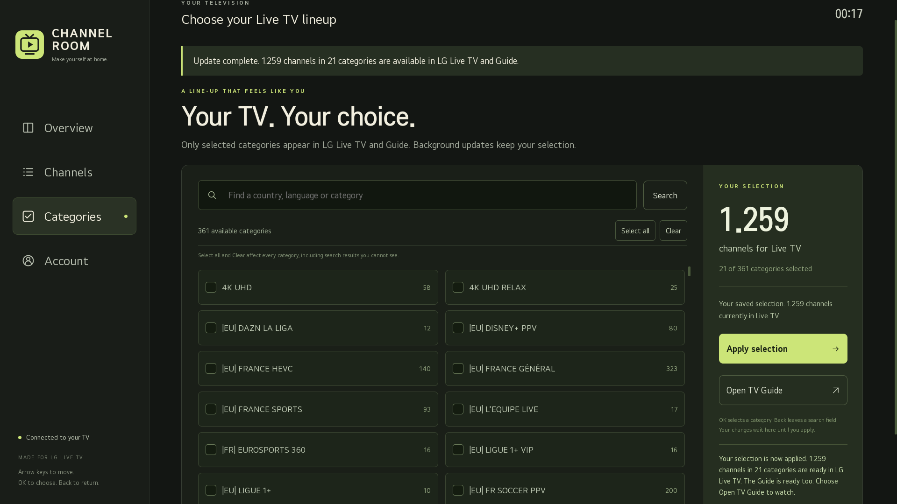
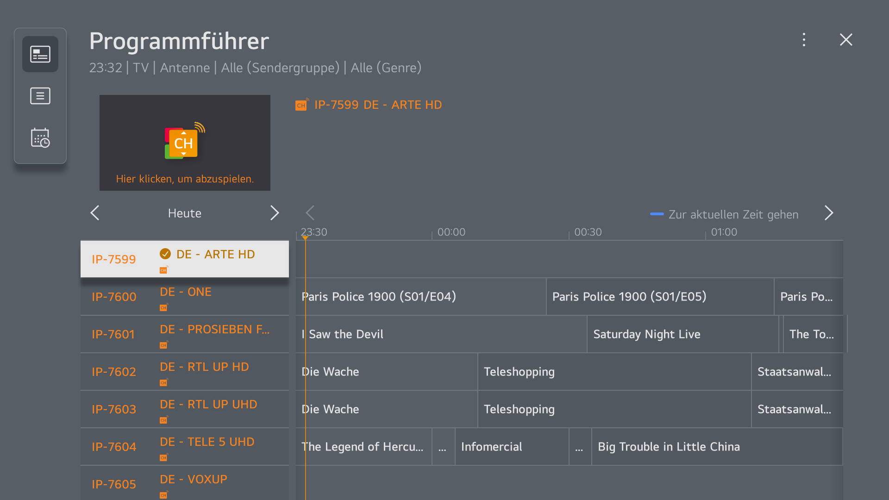

# Xtream webOS

Put selected Xtream live channels **inside LG's existing Live TV channel list and TV Guide**, with hardware video playback, programme listings, persistent channel numbers and updates running on the TV itself.

Includes **Xtream TV / Channel Room**, a remote-friendly TV app for entering an account, choosing categories, browsing channels and refreshing the lineup. Optional debloat instructions document the LG services and unwanted apps removed during development.

**Experimental, firmware-specific integration.** The working runtime was verified on an **LG OLED55G19LA, webOS 6.5.3, firmware 03.53.45**. The public fresh-install tooling has offline tests and read-only validation against that TV; a fresh deployment on a second TV has not been tested. Read [compatibility](docs/COMPATIBILITY.md) and [recovery](docs/RECOVERY.md) before installation. Root is required.



## What works

- Select only the categories you want. Additions **and removals** propagate to native channels, native genre filters and Guide data.
- Tune from LG Live TV, the native Guide, channel numbers or the management app. The native Dmost player uses the TV's video decoder.
- Import XMLTV programme schedules for selected channels, with short-EPG fallback for the current channel.
- Refresh channels every 6 hours and the full Guide every 60 minutes by default. Current-channel updates run between full refreshes. Intervals are configurable.
- Retain channel-number assignments, category selection and LG favourites/locks/groups across refreshes of the same account.
- Restore the Guide snapshot and start services after a real reboot through Homebrew Channel startup hooks. No always-on computer or external streaming server is needed.
- Resume the last successfully watched, still-imported Xtream channel once after reboot when LiveTV starts on LG's empty terrestrial fallback. Another foreground app or an actual channel selection cancels resume.
- Recover a missing page or hidden player app automatically for an unlocked imported LiveTV channel, including recreating the app and restoring the TV's selected channel after startup. Checks exclude other foreground apps, RF, HDMI and locked channels.
- Replace LG's stock IP channel feed while retaining the native TV components needed for playback and Guide navigation.

The development TV ended with **21 selected categories, 1,259 imported channels and 9,664 programme schedules**. ZDF picture and 3sat picture/audio were confirmed on the physical TV; ARTE and KiKA also reported advancing decoded playback. HDMI switching and reboot persistence were checked. These are recorded results from this setup, not guarantees for every provider stream.



The Guide image is an earlier development capture with a different selection. Both images are actual TV compositor captures. That API excludes the hardware video layer, so the preview does not show a video frame.

## Start here

1. [Root the TV and prepare root SSH](docs/ROOTING.md). **Uninstall LG Developer Mode before the first reboot after rooting.** Do not reinstall it on the rooted setup.
2. [Check compatibility](docs/COMPATIBILITY.md). The current native profile targets webOS 6; this is not a universal webOS app.
3. Clone this repository on a computer with Python 3.9+ and OpenSSH:

   ```sh
   git clone https://github.com/youcci/xtream-webos.git
   cd xtream-webos
   python3 tools/xtream_webos.py --host TV_IP --key ~/.ssh/webos_tv doctor
   ```

4. On a fresh compatible rooted TV, install after reading the [full installation guide](docs/INSTALL.md):

   ```sh
   python3 tools/xtream_webos.py --host TV_IP --key ~/.ssh/webos_tv install --replace-lg-channels
   python3 tools/xtream_webos.py --host TV_IP --key ~/.ssh/webos_tv open
   ```

   This backs up native databases, generates QML overlays from **your own TV's firmware**, replaces the stock IP feed, starts the services and builds/installs a private launcher. It does not root the TV or apply optional debloat.

5. In **Xtream TV → Account**, enter your own server address, username and password, then **Save & sync**. Go to **Categories**, choose a small initial selection and press **Apply selection**. Wait for completion and Guide import, then select **Open TV Guide**.

The initial import downloads the category/channel library but imports **zero channels until you select categories**. Unselected categories remain available in the selector without filling LG's channel list. New installations assign numbers from 1001; the historical ZDF proof of concept used 9990, which is not hardcoded in this release.

## Documentation

| Guide | Contents |
| --- | --- |
| [Rooting](docs/ROOTING.md) | Compatibility lookup, tested SlopBro route, Homebrew Channel, Developer Mode removal, SSH |
| [Installation and use](docs/INSTALL.md) | Prerequisites, backups, deployment, account setup, category selection, refresh and screenshots |
| [Compatibility and validation](docs/COMPATIBILITY.md) | Exact tested hardware, schema checks, limits and evidence |
| [Optional debloat](docs/DEBLOAT.md) | Preloads, promotions, all requested app removals and undo commands |
| [Architecture](docs/ARCHITECTURE.md) | Native channel database, Guide, local proxy, provider replacement and cache refresh |
| [Troubleshooting](docs/TROUBLESHOOTING.md) | Missing channels, failed playback, stale Guide, refresh stages and diagnostics |
| [Recovery](docs/RECOVERY.md) | Disable hooks, restore stock IP channels/feed, unmount overlays and retain backups |
| [Existing manual installations](docs/MIGRATION.md) | How this release relates to the original PoC and development TV |
| [Development](docs/DEVELOPMENT.md) | Source layout, API, offline tests, packaging and contributions |
| [Security](SECURITY.md) | Credential storage, local trust boundary and private launcher packages |
| [Change log](CHANGELOG.md) | Development milestones and first public source release |

## Scope and limits

This release supports **live Xtream channels** that the TV can decode through HLS. It does not add VOD/series, DRM support, transcoding, recording, catch-up, universal codec support or a replacement for the TV's tuner firmware. Programme coverage depends on provider EPG IDs and feed quality. A failed upstream stream can still fail in native Live TV.

Importing the entire 21,812-channel development library caused native list/tuning problems. Start with a few categories and grow gradually. There is no established safe maximum for other TVs. Updates run while the TV is operating; power-off/suspend is not an always-on scheduler.

The installer explicitly replaces **all existing IP-source rows**, including any other custom IP provider. Antenna/cable/satellite tables are retained. It masks the original PBS feed executable with a bind mount; it does not erase firmware. Native IEPG, UTP and Dmost remain necessary. Restoring the feed and re-enabling a logically removed LG Channels launcher are separate recovery steps.

## Source, packages and privacy

All project runtime source, the TV UI, deployment/packaging tools, adapted debloat script and offline tests are included. No npm dependencies or native SDK build are required. The installer constructs a Debian-format `.ipk` launcher using Python's standard library.

**Do not share generated launcher IPKs:** they contain a per-TV management token. No account, subscription, SSH key, TV database, full LG QML file or firmware binary is included here. On-device overlays and backups belong to their owner and stay private.

MIT for this project's code and the adapted MIT debloat script. See [LICENSE](LICENSE) and [third-party notices](THIRD_PARTY_NOTICES.md). Rooting uses separately licensed upstream tools. This project is independent of LG and webOSbrew.
