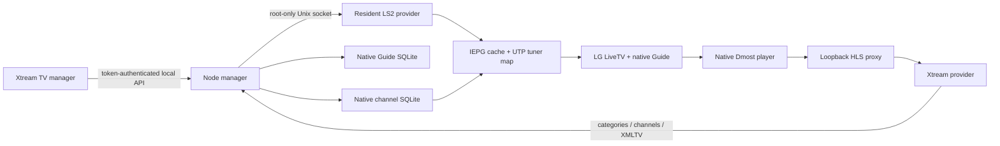

# Native integration architecture

This implementation was derived from observed behavior on the tested firmware. LG does not provide a supported public Xtream-to-native-Guide API. Paths and method contracts below describe this interoperability profile.

## Runtime and persistence

`server.js` serves management APIs, UI, Dmost HTML and stream proxy on **127.0.0.1:17651**. `provider.js` owns the resident LS2 connection and a private Unix socket. Both run as root in `/var/lib/xtream-native` under transient systemd units copied to `/run/systemd/system` at startup.

The `40-native-xtream` Homebrew hook queues `xtream-native-boot.service` without blocking later root hooks. That Linux oneshot job first runs the installed feed-disabling hook, then `control.sh start`: restoring Guide data, mounting overlays and starting the provider/manager. It can progress while `50-debloat` waits for the preload manager. `60-native-xtream` requests the same unit; systemd coalesces an in-flight start, and `RemainAfterExit=yes` avoids repeating completed setup. If the early unit is absent or cannot be queued, the late hook retains the older direct-start fallback. An accepted job that later fails compatibility checks is not bypassed. Homebrew's own root persistence files are not modified.

Provider and manager are started together. The manager waits for the private bridge's ping before touching the native map, so parallel startup cannot fail just because its Unix socket has not appeared yet. It loads only the selected catalogue on the critical path; the full provider library is read lazily when the category UI or metadata refresh needs it. This retains unselected categories without delaying first playback to parse them.

`lib/boot-player.js` waits up to 30 seconds for the hidden Dmost app to appear in the running-app inventory before setting its URL. Earlier setup must not send WAM methods to an absent app and wait on their timeout. It does not launch an app or select a channel; normal foreground/selection guards and missing-player recovery remain in the server. The control/resume processes are Linux services; the Dmost page still supplies LG's native video-player integration. Moving a proxy to another computer does not remove the TV's media/display initialization requirements.

| Path under `/var/lib/xtream-native` | Purpose |
| --- | --- |
| `settings.private.json` | Account, active account, refresh intervals, category IDs, management token |
| `library.private.json` | All provider live metadata and stable number assignments |
| `catalog.private.json` | Only selected/imported channels and categories |
| `catalog-transaction.private.json` | Recoverable pending channel commit |
| `history.json` | Last refreshes/current channel and schedule count |
| `/run/xtream-native/startup-resume.claim` | Private boot-local marker; prevents replay on a service restart and disappears on reboot |
| `guide-cache.sqlite` | Persistent backup of the otherwise volatile Guide DB |
| `originals/`, `patches/` | Private firmware originals and generated overlays |
| `firmware-profile.json` | Native compatibility profile / Guide executable hash |
| `backups/` | Pre-install SQLite snapshots and original provider replies |
| `native.sock` | 0600 IPC socket for allowed native actions |
| `enabled` | Startup marker |

The fresh-install directory is 0700; private JSON and socket permissions are 0600. No account is placed in native channel rows, browser query parameters or native player URLs. The per-TV launcher carries a management token in a fragment; see [security](../SECURITY.md).

## Channels and native categories

The manager downloads `get_live_categories` and `get_live_streams`, ignores decorative `#### ... ####` pseudo-channels, normalizes names, deduplicates IDs and maintains number assignments. A provider response with fewer than half the preceding library's usable channels is rejected to avoid replacing a good catalogue with an unexpectedly partial response.

The full library is filtered by selected category IDs before native import. New numbers start at 1001 and are retained in an assignment ledger even across removal/reappearance. Native IDs follow `11_3_NUMBER_65535_0_0_0`; source 11 / mode 7 and `com.webos.service.dmost` identify the tested native IP path. Owned rows use the `xtream_` code prefix. Category genres use codes 100–997, `genre_type='S'`, `reserved_1='XTREAM'`.

`native-db.js` streams SQL through stdin to SQLite, stages rows in a temporary table and commits them in one transaction. Owned channel and category rows are replaced; refreshes retain unrelated rows. Favourites, locks, skips and channel groups are copied from existing rows when refreshing the same account. **At installation/boot the separate feed-disabling hook removes non-Xtream IP rows** so the old stock feed cannot coexist with this provider. RF tables are untouched.

## Guide import

`epg.js` streams provider XMLTV through a bounded parser into staged SQLite data. It maps one EPG ID to multiple channel variants, handles explicit time offsets and converts UTC to the tested native timestamp representation. Imports target roughly a 36-hour window and the selected catalogue only.

Limits include 512 MB decompressed XML, 64 KB per programme block and 2 million staged rows. Parsing, cancellation, network and SQLite failures retain the previous successful bulk Guide. A failed full download can request short EPG for only the current stream. Programmes are deduplicated rather than copying long descriptions repeatedly for every variant.

Successful merges populate `PBS_BROADCAST_PROGRAM` and `PBS_BROADCAST_SCHEDULE` in `/tmp/epg/PBS_EPG_DB.db`. The manager snapshots a Guide database up to 160 MB into persistent storage; larger snapshots are skipped. Startup restores the cache when no owned schedules are present. Category removals prune schedules and unreferenced owned programmes before refreshing the selected Guide.

## Replacing the stock feed

The original `/usr/sbin/pbs` is bind-masked by an exit-only shell script, and any running original `pbs` process is stopped. Its firmware file stays intact. Our Node provider registers `com.webos.service.pbsw` and supplies the tested capability/status/channel replies. It never downloads LG's channel feed.

The native IEPG cache listens to country-policy subscription updates. Republishing the **unchanged** policy makes it rebuild the simplified channel cache from SQL. The manager then waits for the expected native IDs and toggles UTP's channel sort mode, restoring the original value after 750 ms, to reload the live tuner map.

**Do not emit a provider `changed:true` notification:** on this firmware it selects LG's DB8 provider-import path and can replace directly imported SQL data. Do not restart UTP to refresh a channel list; doing so broke LiveTV bindings during development.

The HTTP manager uses the resident provider's root-only Unix socket for LS2 requests. Repeated child-process `luna-send` calls from the Node 8 HTTP server could abort; this avoids that path. CLI Luna calls retain stdin using `< /dev/zero` because EOF caused silent failures on this firmware.

## Three QML overlays and the stale-cache fix

`prepare.js` generates small changes to the owner's own files:

1. `Pages/Page1/Components/SettingPopupFeed.qml`: expose native genre filtering when Xtream genre codes exist, including outside the stock USA/Korea country condition.
2. `Controllers/ChannelInterfaces/Interfaces.qml`: use the same genre condition and add a bounded refresh timer. It reloads genres and asks for channels when resumed/ready. It does not wait for page readiness before issuing the initial query.
3. `main.qml`: synchronously mark the channel list dirty through `refreshXtreamView()` **before** `registerApp()` on launch, so a restored Guide cannot reuse an old shared list after category removal.

LG can restore its Guide from a CRIU checkpoint without rereading QML. When overlay/executable hashes change, `control.sh` invalidates **only the Guide app's** checkpoint metadata and terminates only that app. The next launch loads the overlays and recreates the snapshot. Other app checkpoints and native TV services are left alone. Full LG QML and binaries are not distributed in this repository.

## Playback and input switching

Native tuning invokes the Dmost page with the selected native channel ID. `player.html` resolves the ID locally, opens a credential-free loopback stream URL and reports decoded dimensions/time/readiness. `proxy.js` requests provider HLS using the active account and rewrites playlist resources through local endpoints. Playback suspends when native ownership/input focus is lost, including HDMI switches, and resumes when LiveTV regains it.

There is no transcoder or external relay. TV codec/transport limits and provider availability still determine whether a particular channel works. The compositor screenshot API omits the hardware video plane; use physical picture/audio confirmation in addition to telemetry.

## Missing-player recovery

A later failure left all channels black even though the provider, catalogue, Guide and native channel selection still worked. Player telemetry had stopped for hours. Reapplying the local Dmost URL restored the current channel, with picture/audio confirmed on the TV. The exact native lifecycle event that dropped the page was not captured.

`playback-watchdog.js` checks every 10 seconds after a 30-second startup grace. A missing heartbeat, or persistently inactive telemetry after a transition grace, triggers native checks. The foreground app must be LiveTV and its actual selected channel must be an imported, explicitly unlocked channel. Healthy playback cancels recovery; attempts are limited to once per minute.

After a later real reboot, the hidden `com.webos.app.livedmost` app was absent. Both its `getChannel` and `setDmostUrl` calls timed out, so the first watchdog's dependency on `getChannel` prevented it from repairing this state. Starting the hidden app made those methods responsive; its new instance then had to receive the selected channel again.

Recovery now reads selection independently through UTP `broadcast/bind` and `broadcast/getCurrentChannel`, matching the read path used by LG's TV adapter. It avoids calling the restricted `apiadapter` service from the provider. If the hidden app is missing, it starts that app, waits for its running-app registration, loads the local URL, waits for the page's `app_ready` telemetry, and replays the **still-selected** channel through UTP `broadcast/changeChannel` with `update:true`. Merely launching LiveTV with an already-selected channel can be a no-op; a native update was verified to emit a real Dmost handoff with the correct underlying broadcast ID. The bridge does not construct a substitute Dmost broadcast ID.

An existing but uninitialized player (`unlocked` plus `_`) can also reload/replay. Explicit native stop/block states, RF/foreign/locked channels and other foreground apps are excluded. Foreground and selection are rechecked before mutations and replay; it never substitutes a history/default channel.

The resident bridge additionally permits running-app inventory and these two UTP reads. No core TV service restart or channel/account import is involved. Status exposes `starts`, `reloads`, `replays`, `reason`, `lastStage` and sanitized errors. Fresh telemetry reporting an active upstream/decoder failure remains a separate playback problem. These repairs cover observed missing-page/missing-app states rather than guaranteeing that all firmware playback failures are eliminated.

## Last-channel startup resume

`startup-resume.js` is separate from missing-player recovery. It snapshots the persisted last successfully played channel and exclusively creates a private marker under `/run/xtream-native` (0700 directory, 0600 marker). `/run` is boot-local tmpfs on the tested TV; it survives process restarts and clears on reboot. Its kernel `boot_id` was observed to repeat after a real reboot, so that ID is not used. A subsequent management-service restart in that boot cannot select the channel again. A service first started more than five minutes after boot skips resume; this is not a suspend/wake hook.

After successful native database/map initialization, it checks every second within that boot window. The page's `app_ready` acknowledgement opens the fast path immediately; there is no additional fixed service-start sleep. If it never arrives, a ten-second maximum page grace permits selection and the existing missing-app recovery path rather than deadlocking on readiness. LiveTV must be foreground, and observations spanning at least two seconds must show LG's exact empty, skipped, unlocked terrestrial fallback (`1_0_1_0_0_0_0`). A configured RF channel, imported/foreign channel, another app, changed history or removed target cancels resume. Sync/account writes defer the check; native request failures back off for five seconds. Resume does not launch from Home or HDMI.

It selects the saved channel through LiveTV's ordinary `channelChange` launch, retaining native lock handling. At most one selection is sent, including when its acknowledgement is lost. The existing watchdog can then recreate a missing player for the newly selected unlocked channel. `startupResume` status distinguishes `waiting`, `awaiting-playback`, `resumed`, `skipped` and `failed`; a launch acknowledgement alone is not success. Resume requires fresh active telemetry with decoded video dimensions. No account/category data is changed.

`startupResume.timings` records seconds of TV uptime at resume-worker construction (`serviceStarted`), native readiness, page readiness, fallback observation, channel selection and decoded-video observation. Worker construction follows Node startup and initial catalogue/settings loading; use systemd's `ExecMainStartTimestampMonotonic` for process-start comparisons. These distinguish integration waits from the TV's own boot, web-app runtime startup and provider buffering. Decoded-video time is when fresh telemetry is observed, not a physical panel stopwatch measurement.
